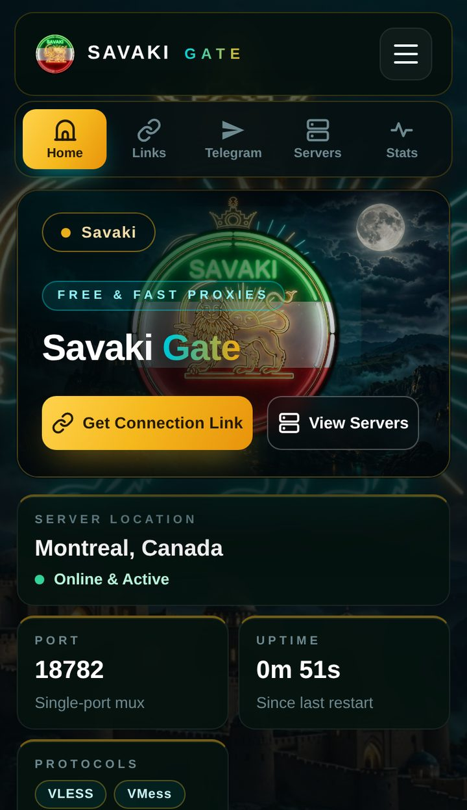

# Savaki Gate

یه پنل و گیت‌وی چندپروتکله‌ست که روی Node.js اجرا می‌شه؛ همه‌چی روی یه پورته و از توی مرورگر گوشی هم کامل کار می‌کنه. نصبش دو تا فایل بیشتر نیست: `index.js` و `package.json`.

  

## چی داره

- پروتکل‌ها: VLESS و Trojan و Shadowsocks و WireGuard و SOCKS5 و MTProto — با موتورهای sing-box و xray و telemt
- لینک سابسکریپشن برای همه کلاینت‌های معروف، به صورت تکی و گروهی
- یه روش با رله گوگل که بهت یه آدرس ثابت می‌ده؛ یه بار فعالش می‌کنی و دیگه لازم نیست هر بار لینک عوض کنی. راهنماش تو خود پنل هست
- یه صفحه جدا واسه تلگرام که لینک پروکسی MTProto رو همون‌جا با دکمه اتصال و QR می‌ده
- سه تا بک‌گراند داره: شیر و خورشید (پیش‌فرض)، درفش کاویانی و پرچم هخامنشیان، که از توی پنل عوض می‌شن
- آمار زنده سرور و مصرف حافظه سبک — روی هاست‌های رایگان کوچیک هم راحت اجرا می‌شه

## نصب

۱. اول از همه هاستی که می‌گیری باید Node.js داشته باشه؛ هاست وب معمولی به دردش نمی‌خوره.

۲. یا فایل‌های `index.js` و `package.json` رو از همین‌جا بردار، یا زیپ آماده رو از [صفحه ریلیزها](https://github.com/saeedsavaki/Savaki/releases) دانلود کن و هر دو فایل رو آپلود کن.

۳. سرور رو استارت کن.

۴. آدرس پنل رو باز کن؛ بار اول ازت می‌خواد یه رمز بسازی. لینک‌های اتصال و ساب توی صفحه لینک‌هاست.

۵. اگه موقع اضافه‌کردن ساب به کلاینت به مشکل خوردی، از روش گوگل استفاده کن؛ راهنمای فارسیش توی صفحه لینک‌های پنل هست.

## دانلود

آخرین نسخه: [Savaki Gate v1.0.0](https://github.com/saeedsavaki/Savaki/releases/tag/v1.0.0)

## کانال تلگرام

خبرها و آپدیت‌ها رو تو کانالم می‌ذارم: [@saeedsavaki](https://t.me/saeedsavaki)

